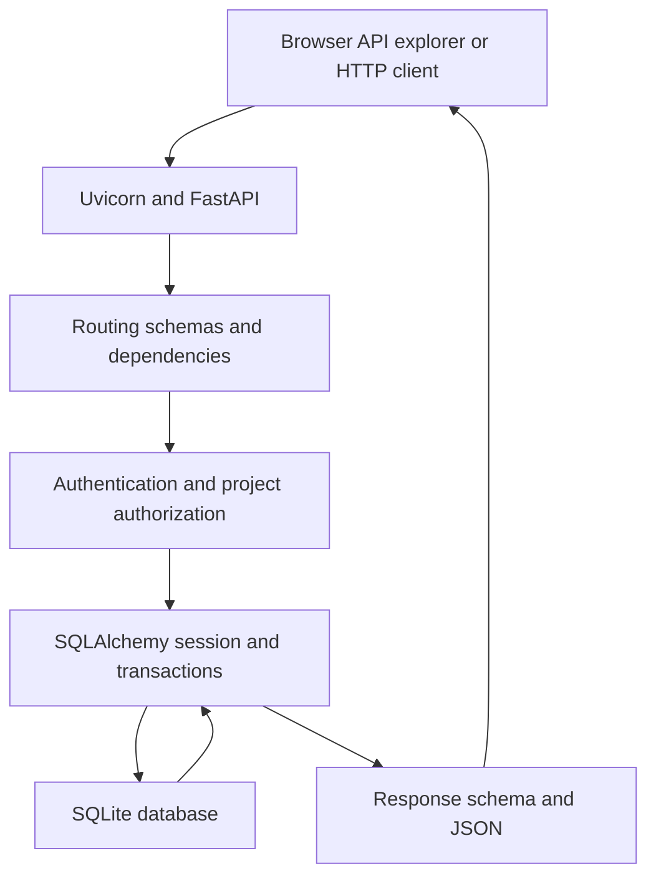
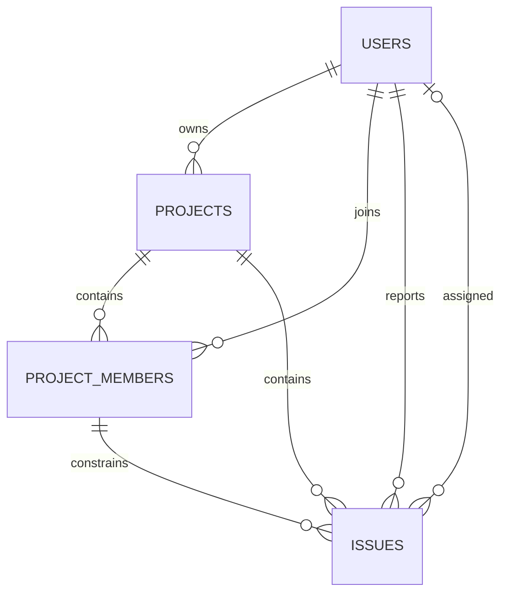

# BugTrack Pro Interview Handbook

Backend architecture and interview preparation

Version 0.3.0 | Milestones 1 through 3 | Verified 22 October 2026

This handbook explains the current BugTrack Pro rebuild from the first request to the database constraints. It is written for a college placement interview: understand the behavior, trace it in the code, demonstrate it, and explain the tradeoffs. The verified snapshot contains 12 application API operations, four database tables, and 70 passing test cases.

The current product is a backend foundation for a team issue tracker. Registration, login, project management, and project membership are implemented. The issue table is implemented and tested at the database level, but issue-management endpoints, comments, a dashboard, a frontend, Docker packaging, and deployment are not implemented in this rebuild. Keep that distinction in every interview answer.

## 1 Project overview and honest scope

### The problem

A team needs a shared place to organize work and control who may access each project. A person may belong to several projects, and the same project may contain several people. Logging into the application must not give someone access to every team's data.

BugTrack Pro addresses that foundation with accounts, authenticated requests, project ownership, and project memberships. The planned next layer is issue reporting, assignment, and status changes. The schema already supports those relationships so that issue assignments cannot refer to people outside the project.

### What exists in this version

| Capability | Status | Evidence |
| --- | --- | --- |
| Register an account | Implemented | `POST /api/auth/register` |
| Hash and verify passwords | Implemented | `app/security.py`, authentication tests |
| Login and issue a 30 minute JWT | Implemented | `POST /api/auth/login` |
| Return the authenticated account | Implemented | `GET /api/me` |
| Create a project and owner membership together | Implemented | `POST /api/projects`, rollback test |
| List only the user's projects | Implemented | Membership-filtered database query |
| Read project details and members | Implemented | Membership dependencies |
| Edit project details | Implemented for owner only | Owner dependency and negative tests |
| Add and remove registered members | Implemented with restrictions | Membership endpoints |
| Issue model and membership constraints | Implemented at database level | `Issue`, model tests |
| Create or update issues through the API | Planned | No issue routes exist yet |
| Comments and change history | Planned | No comment or history table exists |
| Frontend and dashboard | Planned | Swagger is the API explorer, not the product frontend |
| Docker, CI, hosted demo, PostgreSQL validation | Planned | Not configured or verified in this rebuild |

The older project and resume may mention additional features. This handbook describes the rebuilt source in this pack, not the older version. Do not carry older claims into an explanation of this snapshot without separately demonstrating them.

### Useful ways to introduce the project

**Thirty second explanation:** BugTrack Pro is a project-based issue-tracker backend built with Python, FastAPI, SQLAlchemy, and SQLite. Its current version supports account registration, password hashing, JWT login, and project membership. Owners manage a project's members, while other members can read its details. Access is checked against the database on every request. The project also has an issue model with composite foreign keys that prevent cross-project assignments, and 70 automated test cases.

**Two minute explanation:** Start with the problem of private team projects. Explain the account and membership model, then trace a request through validation, token verification, the membership query, and serialization. Describe why the owner's ID comes from the authenticated account, why project creation and owner membership are committed together, and why a removed member's existing token no longer grants project access. Finish by identifying the current boundary: issue APIs and the frontend are the next milestones, and public deployment needs additional operational and security work.

These are practice explanations of the implementation. Describe your own contribution accurately. If asked about AI assistance, explain that assistance was used during development and distinguish generated code, code you reviewed, behavior you tested yourself, and decisions you can independently defend.

## 2 Requirements and user roles

### Functional requirements implemented now

- A person can register with a name, valid email address, and password.
- An existing account can log in and obtain an expiring access token.
- A protected request identifies the account from that token.
- Any logged-in user can create a project and becomes its owner and first member.
- A user sees only projects whose membership table contains their account.
- Project members can view project details and the member list.
- Only the owner can edit the name or description, add an existing account, or remove an eligible member.
- A user cannot join the same project twice, and a project owner cannot be removed through the membership API.
- Removing a member removes project access on subsequent requests, while their account and login remain valid.

### Roles are local to each project

There is no global administrator role. Ownership is stored in `projects.owner_id`. Membership is stored in `project_members`. The response role is computed as `owner` when the membership user matches the project's owner and `member` otherwise. There is no separately stored role column that could drift out of sync with `owner_id`.

A person can own Project A, be a member of Project B, and be an outsider to Project C. Authorization must therefore consider both the current account and the requested project, not merely whether the account is logged in.

### Quality goals and their limits

Correctness is supported by validation, foreign keys, unique keys, transactions, and tests. Maintainability is supported by separate routing, security, schema, database, and permission modules. Local setup uses SQLite to avoid requiring an external database server. No throughput, latency, uptime, or production-user claim has been measured. Availability and scaling are future deployment concerns, not proven outcomes of this snapshot.

## 3 Technology stack and dependency management

| Component | Verified installed version | Purpose |
| --- | --- | --- |
| Python | Verified on 3.14.4; project requires 3.12 or newer | Application language |
| FastAPI | 0.159.1 | Routing, dependency injection, request handling, OpenAPI |
| Uvicorn | 0.54.0 | ASGI server that runs the application |
| SQLAlchemy | 2.0.55 | Table mapping, queries, sessions, transactions |
| SQLite | Python's installed SQLite driver | Local relational database |
| Pydantic | 2.14.1 | Input validation and output models |
| pwdlib | 0.3.1 | Password hashing interface |
| argon2-cffi | 25.1.0 | Argon2 implementation used by pwdlib |
| PyJWT | 2.15.1 | JWT creation and verification |
| email-validator | 2.3.0 | Validation used by Pydantic `EmailStr` |
| pytest | 9.1.1 | Automated test execution |
| HTTPX2 | 2.16.0 | HTTP client used by the installed Starlette TestClient |

`pyproject.toml` declares the direct dependencies and supported version ranges. `uv.lock` records the resolved dependency versions. `requirements.txt` exports pinned packages for people who prefer standard Python tooling. The development extra includes pytest and HTTPX2. The package is configured with `tool.uv.package = false`, so this is an application environment rather than a distributable installed Python package.

FastAPI does not replace the database or server. Uvicorn receives HTTP connections, FastAPI selects routes and dependencies, Pydantic validates data, and SQLAlchemy communicates with SQLite. Keeping these responsibilities separate makes interview explanations more precise.

## 4 Setup and configuration

### Run with uv

Open PowerShell in the `bugtrack-pro` project directory:

```powershell
uv sync --extra dev --locked
uv run uvicorn app.main:app --reload --port 8001
```

Visit `http://127.0.0.1:8001/docs`. The root route `/` identifies the current milestone. `GET /api/health` executes a real database query and should return `{"status":"ok","database":"connected"}`.

### Run with standard Python tools

```powershell
python -m venv .venv
.\.venv\Scripts\python.exe -m pip install -r requirements.txt
.\.venv\Scripts\python.exe -m uvicorn app.main:app --reload --port 8001
```

These commands do not require activating the virtual environment. Using the environment's Python explicitly avoids accidentally running a different interpreter.

### Database configuration

By default, the SQLite file is `bugtrack.db` in the project root. Its default absolute location is derived from `app/database.py`, so the default does not depend on the shell's working directory. `DATABASE_URL` can override the URL. For a separate interview-practice database, open a separate PowerShell window in the project root:

```powershell
$env:DATABASE_URL = "sqlite:///./interview-demo.db"
uv run uvicorn app.main:app --port 8002
```

Use `http://127.0.0.1:8002/docs` for that isolated practice instance. A relative database path supplied through the environment is resolved relative to the process's working directory. This is a separate instance; its tokens and IDs must not be mixed with the application on port 8001. Keep your existing database intact.

`create_database_engine` accepts a SQLAlchemy URL, but PostgreSQL support is not verified and a PostgreSQL driver is not included in the project's direct dependencies. Merely accepting a URL does not establish cross-database support.

### Token signing configuration

`AuthSettings` is a frozen dataclass. It has a secret key and an access-token lifetime of 30 minutes. It rejects secrets shorter than 32 UTF-8 bytes and nonpositive lifetimes. The secret is excluded from its normal representation through `repr=False`.

If `BUGTRACK_SECRET_KEY` is absent, each app construction generates a random key using `secrets.token_urlsafe(32)`. This makes local startup convenient, but a restart changes the key and invalidates existing tokens. Set the same generated environment key before starting the application when you need tokens to survive restarts:

```powershell
$env:BUGTRACK_SECRET_KEY = .\.venv\Scripts\python.exe -c "import secrets; print(secrets.token_urlsafe(32))"
uv run uvicorn app.main:app --reload --port 8001
```

The command generates a new key each time it is executed. Keeping tokens valid across later shell sessions requires retaining the same key in an appropriate secret store. No `.env` loader is configured. Setting a value in a `.env` file alone will not load it. Multiple worker processes must share a stable configured key. Passwords, keys, live tokens, and the database should not be committed to source control.

### Tests

```powershell
uv run --extra dev pytest -q
```

Or use ` .\.venv\Scripts\python.exe -m pytest -q` after installing requirements. Tests use temporary databases, not the normal application database. If a restricted environment prevents access to its default temporary folder, provide a new disposable directory with pytest's `--basetemp` option. Never point that option at a directory containing useful files: pytest manages and may clear its base temporary directory.

## 5 Architecture and request lifecycle

The application is a modular monolith: one FastAPI application with modules for related responsibilities. It is not a microservice system. Most endpoint functions are ordinary synchronous `def` functions, matching the synchronous SQLAlchemy sessions used here. This is not an asynchronous database implementation.



### Application startup

Importing `app.main` constructs `app` through `create_app`. The factory attaches the database engine and authentication settings to `application.state`, includes the authentication and projects routers, and registers error handling and utility routes. FastAPI's lifespan startup calls `initialize_database`, which imports the models and creates missing tables with `Base.metadata.create_all`.

`create_all` does not migrate existing tables after their definitions change. This version has no migration history. Introduce a migration tool before changing a schema containing data that must be preserved. Startup does not create demo accounts or projects automatically.

### A protected project request

Consider `GET /api/projects/7`. FastAPI resolves `get_member_project`, which depends on the current user and a database session. `get_current_user` reads a bearer token, verifies it, and loads the corresponding user. `get_member_project` then searches for project 7 joined to a membership for that user. If it finds the row, the route serializes it through `ProjectRead`. Otherwise it returns `404`.

The path ID is not evidence of permission. The current user is not taken from an editable request-body field. A database relationship and a reusable dependency determine access. Dependencies can share the same request-scoped session through FastAPI's dependency resolution; application code does not create a new database engine for each route call.

### A request's database session

`get_db(request)` constructs a SQLAlchemy `Session` using the engine attached to that application. It yields the session to the request and closes it when dependency cleanup runs. `autoflush=False` prevents implicit flushes before queries; endpoints explicitly flush or commit writes. The session is a unit of work, not the same object as the long-lived engine. Test applications supply their own engine and therefore avoid the normal database.

## 6 Source code map and function walkthrough

```text
bugtrack-pro/
  app/
    __init__.py
    main.py
    database.py
    models.py
    schemas.py
    settings.py
    security.py
    auth.py
    permissions.py
    projects.py
  tests/
    conftest.py
    test_auth.py
    test_health.py
    test_models.py
    test_projects.py
  docs/
    milestone-2.md
    milestone-3.md
    INTERVIEW_GUIDE.md
    openapi.json
  pyproject.toml
  uv.lock
  requirements.txt
  README.md
  .gitignore
```

### main py

`create_app(database_engine, auth_settings)` is the application factory. Tests can supply a temporary engine and fixed test settings without changing production globals. Its lifespan function creates missing tables. The `validation_error` handler returns only each error's location, message, and type, omitting submitted input and validation context. This helps prevent a password from being echoed in a validation error. The root handler reports the project and milestone. The health handler performs `SELECT 1` and maps SQLAlchemy connection errors to a generic `503` response.

### database py

`Base` is the shared declarative base for the mapped tables. `create_database_engine` builds the engine and attaches a connection listener for SQLite. That listener runs `PRAGMA foreign_keys=ON` for each new connection. Without it, declaring foreign keys in a SQLite schema is insufficient to ensure that this application enforces them. `initialize_database` registers the models before creating tables. `get_db` supplies a request-scoped session and closes it afterward.

### models py

`utc_now` records naive datetime values under an explicit UTC convention. `IssueStatus` and `IssuePriority` define the allowed strings. `enum_column` configures SQLAlchemy to store enum values rather than Python member names, use a nonnative representation, validate string values, and create database check constraints. `User`, `Project`, `ProjectMember`, and `Issue` describe the four tables. `relationship` declarations support object navigation, while foreign-key constraints enforce database integrity; the two concepts have different responsibilities.

### schemas py

`LoginRequest` validates credentials and normalizes email addresses. `RegisterRequest` adds a trimmed name and a stronger minimum password length. `UserRead` exposes only safe account fields. `TokenResponse` describes the token, its type and lifetime, and the user's public profile. `ProjectCreate`, `ProjectUpdate`, `ProjectRead`, `ProjectMemberCreate`, and `ProjectMemberRead` define the project API contracts. Their full rules appear in the validation chapter.

### settings py and security py

`AuthSettings.from_environment` loads a configured signing key or generates a development key. `get_auth_settings` reads settings from the current application. `hash_password` delegates hashing to pwdlib. `verify_password` checks the submitted password and handles an unrecognized stored hash by returning false. `create_access_token` signs the user ID, issue time, expiry, and issuer. `decode_access_token` verifies the expected signature algorithm and required claims, then returns a positive user ID or `None`.

The module creates one dummy password hash at import. Login verifies against it for an unknown email, avoiding a cheap early return that entirely skips the hashing operation. This reduces a timing distinction; it does not prove constant-time account lookup or eliminate all account enumeration risks.

### auth py

`unauthorized` constructs a `401` error with `WWW-Authenticate: Bearer`. `get_current_user` verifies a bearer token and loads its user, so a token referring to a nonexistent account is rejected. `register` checks email uniqueness, hashes the password, saves the user, and catches a duplicate-insertion race through the database constraint. `login` compares the password, returns the same credential error for unknown accounts and wrong passwords, and returns a signed token on success. `me` uses the current-user dependency and returns `UserRead`.

### permissions py

`get_member_project` joins projects to memberships and filters by both project ID and authenticated user ID. `require_project_owner` first requires that membership, then compares the project's owner ID to the current user's ID. The route declares the access policy through the dependency it chooses. This is the central place to inspect when explaining project authorization.

### projects py

`read_member` creates the public member response and derives the role. `create_project` saves a project and its owner membership in one transaction. `list_projects` filters by membership and sorts newest first, breaking time ties by descending project ID. `get_project` serializes a permitted project. `update_project` applies only explicitly submitted fields. `list_members` eagerly loads users and orders memberships by join time, then user ID. `add_member` resolves a registered email, rejects duplicates, and inserts a membership. `remove_member` protects the owner and maps an issue-related foreign-key conflict to `409`.

## 7 Database design and complete data dictionary

### Relationships



A user can own several projects. Projects and users have a many-to-many membership relationship, represented by the join table. A project can contain several issues. Every issue has one reporter and may have one assignee. The two composite membership constraints add a project-specific condition to those user references.

### users

| Column | SQLAlchemy type | Null allowed | Default | Meaning and rules |
| --- | --- | --- | --- | --- |
| id | Integer | No | Generated primary key | Account identity |
| name | String 100 | No | None | Check requires at least two characters after database trim |
| email | String 255 | No | None | Unique indexed account email |
| password_hash | String 255 | No | None | Encoded password hash; not a plaintext password |
| created_at | DateTime | No | `utc_now` | Account creation time under the UTC convention |

The API lowercases and trims email before saving it. The database's ordinary email uniqueness does not independently implement that normalization. A direct database writer must preserve the application's normalization policy. The relationship `memberships` provides access to a user's membership objects.

### projects

| Column | SQLAlchemy type | Null allowed | Default | Meaning and rules |
| --- | --- | --- | --- | --- |
| id | Integer | No | Generated primary key | Project identity |
| name | String 100 | No | None | Check requires a trimmed length of at least two |
| description | Text | No | Empty string | Project description |
| owner_id | Integer | No | None | Indexed foreign key to users.id |
| created_at | DateTime | No | `utc_now` | Creation time |

The relationships are `owner`, `members`, and `issues`. Project names are not unique: two projects may be called College Website. Ownership is not accepted from a creation or update request. There is no ownership-transfer endpoint.

### project members

| Column | SQLAlchemy type | Null allowed | Default | Meaning and rules |
| --- | --- | --- | --- | --- |
| project_id | Integer | No | None | Foreign key to projects.id; first primary-key component |
| user_id | Integer | No | None | Foreign key to users.id; second primary-key component |
| joined_at | DateTime | No | `utc_now` | Membership creation time |

The primary key is the pair `(project_id, user_id)`. It identifies one person's membership in one project and prevents duplicate memberships without requiring a separate membership ID. Relationships expose the matching `project` and `user` objects. A user ID, project ID, and membership pair are different identifiers and must not be substituted for one another.

### issues

| Column | SQLAlchemy type | Null allowed | Default | Meaning and rules |
| --- | --- | --- | --- | --- |
| id | Integer | No | Generated primary key | Issue identity |
| project_id | Integer | No | None | Foreign key to projects.id |
| reporter_id | Integer | No | None | Foreign key to users.id and membership constraint |
| assignee_id | Integer | Yes | Null | Optional user reference and membership constraint |
| title | String 200 | No | None | Check requires trimmed length of at least three |
| description | Text | No | Empty string | Issue details |
| status | Enum string | No | open | open, in_progress, resolved |
| priority | Enum string | No | medium | low, medium, high, critical |
| created_at | DateTime | No | `utc_now` | Creation time |
| updated_at | DateTime | No | `utc_now` | SQLAlchemy updates it on an ORM-issued row update |

The relationships are `project`, `reporter`, and `assignee`. Explicit `foreign_keys` arguments disambiguate the reporter and assignee relationships to the same users table. The index `ix_issues_project_status` covers `(project_id, status)` for anticipated project/status queries. No issue API currently exposes this model.

### Composite foreign keys explained with an example

Suppose user 20 belongs to project 3 but not project 8. A foreign key from `assignee_id` to `users.id` only proves user 20 exists. It would not prevent assigning that user to an issue in project 8.

The constraint on `(project_id, assignee_id)` additionally requires a matching `(project_id, user_id)` in `project_members`. Therefore `(8, 20)` is rejected unless user 20 belongs to project 8. The reporter is checked the same way. A null assignee is allowed, so an issue can remain unassigned. These rules continue to apply to direct writes through database connections that have foreign-key enforcement enabled.

### Important database subtleties

- The API creates the owner's membership atomically, but no separate database constraint requires every owner to have a membership row. Direct database maintenance must preserve that invariant.
- Column defaults and `onupdate` here are SQLAlchemy-side defaults, not a complete set of server-side defaults or database triggers. Raw SQL writers must supply required values and manage update timestamps themselves.
- Datetimes are stored without timezone information and interpreted as UTC. Responses do not automatically add a UTC offset. A future API should consider explicit timezone-aware serialization.
- SQLite does not enforce declared `VARCHAR(n)` lengths as a typical strict varchar database would. Pydantic enforces API maximum lengths; check constraints enforce the minimum trimmed name/title lengths shown in the models.
- The schema does not configure cascading deletions. Referential integrity is intentionally important to member removal; deleting a referenced membership can fail.
- Enum check constraints restrict stored statuses and priorities. They do not enforce a workflow such as only allowing open to move to in_progress. There is no implemented status-transition service yet.

## 8 Validation and API schemas

Input schemas use `extra="forbid"`. Unknown request fields cause a validation error instead of being silently accepted. Pydantic validation is not a blanket declaration that every field uses strict typing; this project does not enable global strict mode.

| Schema | Fields and behavior |
| --- | --- |
| LoginRequest | EmailStr up to 255; trim and lowercase before validation; SecretStr password 1 to 128 characters |
| RegisterRequest | Inherits email behavior; name 2 to 100 after trimming; password 12 to 128 |
| UserRead | id, name, email; reads attributes from an ORM object |
| TokenResponse | access_token, token_type default bearer, expires_in seconds, UserRead |
| ProjectCreate | Trimmed name 2 to 100; description up to 10000, default empty string |
| ProjectUpdate | Optional name and description; at least one must be submitted; explicit null is rejected |
| ProjectRead | id, name, description, owner_id, created_at |
| ProjectMemberCreate | A normalized valid email, at most 255 characters |
| ProjectMemberRead | UserRead, role constrained to owner or member, joined_at |

### Normalization and secrets

Names are trimmed before their length is checked. Emails are trimmed and lowercased as the application's identity policy. Passwords are not trimmed: leading or trailing spaces can be intentional. SecretStr helps keep a password out of an ordinary model representation, but it is not password hashing. The endpoint calls `get_secret_value()` and passes the actual submitted password to the hashing library.

The application removes submitted input from all request-validation error responses. A typical error contains a `detail` list with `loc`, `msg`, and `type`, not the raw input. This protects error responses; it is not a comprehensive log-scrubbing solution for every possible logging configuration.

### Partial updates

PATCH accepts only the fields being changed. `model_dump(exclude_unset=True)` avoids replacing omitted fields with defaults. An omitted description remains unchanged; an empty string intentionally clears it. Explicit null and an empty update body are rejected. Unknown fields such as `owner_id` are also rejected, preventing clients from changing ownership through this endpoint.

Project IDs and member user IDs declared with `Path(gt=0)` must be positive integers. An invalid integer or nonpositive value is a validation issue. A well-formed positive ID that cannot be accessed is handled as a missing resource instead.

## 9 Authentication and token security

### Registration

Registration normalizes and validates the input, checks for an existing email, hashes the password with the recommended pwdlib configuration, and commits the user. In the verified environment, the stored format is Argon2id. The response is constructed through `UserRead`, so it contains no password or password hash.

A password hash is not encryption that the application later decrypts. The hashing library verifies a candidate password against the encoded hash. Its encoded form includes algorithm parameters and a salt. Tests confirm that two accounts with the same password receive different hashes. This reduces the usefulness of precomputed hashes; it does not make weak passwords safe from all attacks. See the official hashing reference in the final chapter for further reading.

The verified recommended hasher used Argon2id version 19, a 16-byte salt, a 32-byte output, time cost 3, memory cost 65536 KiB (64 MiB), and parallelism 4. Those are the installed library's recommended parameters, not separately hardcoded application settings. Encoded hashes retain their parameters for verification. The current verify function does not implement an automatic rehash-and-save upgrade when recommendations change. The key-length check likewise verifies length, not the entropy of a manually chosen secret; use a securely generated key.

The preliminary duplicate-email check improves the error response, but the unique database rule remains necessary. Another request could insert the same email between the check and the commit. The endpoint rolls back after an integrity error and recognizes the duplicate if a matching user now exists.

### Login

Login loads the user by normalized email and verifies the supplied password. For an unknown email, it verifies against a dummy hash rather than skipping password verification. Both an unknown account and a wrong password return `401` with `Invalid email or password` and a bearer authentication challenge. Registration still reports an existing email through `409`, so the system does not claim to eliminate account enumeration.

On successful login, response headers include `Cache-Control: no-store` and `Pragma: no-cache`. The response contains an access token, `token_type: bearer`, `expires_in: 1800`, and a public user profile. This is a JSON credentials endpoint; it is not an implemented OAuth authorization server, social-login flow, or OAuth password-form endpoint.

### JWT contract

| Item | Current value or behavior |
| --- | --- |
| Algorithm | HS256; verification uses a fixed allowed algorithm list |
| Signing key | AuthSettings secret key |
| sub | String form of the user ID |
| iat | UTC time when issued |
| exp | UTC issue time plus the configured lifetime |
| iss | bugtrack-pro |
| Required claims | sub, iat, exp, iss |
| Verification | Signature, accepted algorithm, issuer, expiry and library claim validation |
| Final identity check | Convert subject to a positive integer and load that user |

The JWT payload is signed, not encrypted. A signature detects unauthorized changes; it does not hide the content. Passwords and membership lists are not included in the token. No audience claim, refresh token, token ID, per-token revocation list, or key-rotation scheme is implemented. An existing account's copied token remains usable until expiry or signing-key replacement, subject to current account and membership checks.

### Bearer authentication in practice

Send `Authorization: Bearer <access_token>` outside Swagger. In Swagger's Authorize dialog, paste only the full token value; the UI supplies the bearer prefix. The value is the login response string, often beginning with `eyJ`, not the URL of the registration endpoint and not the account's password.

`HTTPBearer(auto_error=False)` allows the application's own dependency to produce a consistent `401`. Invalid, expired, wrong-issuer, wrong-algorithm, or unresolvable-user tokens cannot pass `get_current_user`. The account is loaded on each protected request rather than trusting a supplied email or a role supplied by the client.

Clicking Logout in Swagger clears its saved authorization. It does not call a server logout endpoint, revoke a copied token, or delete the account. If the server restarts with a new development key, obtain a new token by logging in again.

## 10 Authorization and membership rules

| Operation | Owner | Other member | Authenticated outsider | Anonymous |
| --- | --- | --- | --- | --- |
| Create a project | Allowed | Allowed | Allowed | 401 |
| List projects | Own memberships | Own memberships | Own memberships | 401 |
| Read project | Allowed | Allowed | 404 | 401 |
| List members | Allowed | Allowed | 404 | 401 |
| Edit project | Allowed | 403 | 404 | 401 |
| Add member | Allowed | 403 | 404 | 401 |
| Remove eligible member | Allowed | 403 | 404 | 401 |

For create and list, owner/member/outsider are relative to an existing project, not global roles. Any authenticated account can create its own project. A list request returns an empty list if that user belongs to no projects.

The same `404 Project not found` response is used when a project is absent and when the account is not a member. A member attempting an owner-only operation receives `403`, because that member may already see the project. These conventions reduce disclosure of private project existence through these specific resource endpoints; they are not a universal guarantee against every side channel.

Membership is queried from the database for each request. A removed member can still be logged in and call `/api/me`, but can no longer access that project using the same token. This is why embedding an old membership list in the token would be a poor fit for immediate membership revocation.

Adding a member grants access immediately to an existing registered account. It does not send an invitation email and has no acceptance workflow. Member responses include the account's email, which is visible to project members. Treat that visibility as a product choice to revisit if the application handles more sensitive organizations.

Removing the owner returns `409`. Removing a nonmember returns `404`. Removing a person referenced by an issue's reporter or assignee constraints returns `409` and rolls back the deletion. Reassignment can remove an assignee dependency; a reporter dependency remains while that issue exists. Future deactivation or historical-membership design is needed for more flexible offboarding.

## 11 Transactions and failure handling

### Why project creation needs one transaction

Creating a project without its owner membership would violate the access policy: even the owner would not pass the membership query. The endpoint adds the project, calls `flush()` to obtain its generated ID, adds the owner membership, and calls `commit()` once. A SQLAlchemy error triggers `rollback()`, undoing both pending records. The suite creates a rejecting database trigger to verify that a membership insertion failure leaves neither record behind.

### Database actions to distinguish

| Action | Meaning in this application |
| --- | --- |
| add | Put a new ORM object into the session's pending work |
| flush | Send pending changes to the database within the current transaction |
| commit | Flush if needed and finish the transaction successfully |
| rollback | Undo the transaction and recover the session after failure |
| refresh | Reload values from the database after a successful write |
| close | Release the session's resources at request cleanup |

A flush is not a successful final save. A prior query can already have started a session transaction, which is why these routes use the existing session's explicit commit/rollback pattern rather than blindly nesting a new transaction block around all work.

### Duplicate races and deletion conflicts

Registration and membership addition both have a precheck plus a database uniqueness rule. The precheck is convenient; the database closes the race window. After an integrity error, the code rolls back before checking whether the duplicate now exists. Member removal relies on foreign keys as the final authority for linked-issue conflicts and translates that failure into a useful `409`.

The application does not currently translate every possible database exception into a custom API error. Unexpected failures can result in `500`. Project update commits directly; request session cleanup handles an outstanding failed transaction when the session closes. Concurrent edits have no version check and may overwrite one another. SQLite lock contention is not given a dedicated retry policy. These are improvement topics, not completed concurrency guarantees.

## 12 Complete application API reference

All paths below are relative to the server, normally `http://127.0.0.1:8001`. There are 12 application operations across nine distinct paths. Generated documentation endpoints `/docs`, `/redoc`, and `/openapi.json` are additional framework routes. The exported `docs/openapi.json` supplies the machine-readable schemas. Some runtime error responses are not exhaustively declared in OpenAPI and may appear as Undocumented in Swagger.

| Method | Path | Access | Success |
| --- | --- | --- | --- |
| GET | / | Public | 200 |
| GET | /api/health | Public | 200 |
| POST | /api/auth/register | Public | 201 |
| POST | /api/auth/login | Public | 200 |
| GET | /api/me | Authenticated | 200 |
| POST | /api/projects | Authenticated | 201 |
| GET | /api/projects | Authenticated | 200 |
| GET | /api/projects/{project_id} | Project member | 200 |
| PATCH | /api/projects/{project_id} | Project owner | 200 |
| GET | /api/projects/{project_id}/members | Project member | 200 |
| POST | /api/projects/{project_id}/members | Project owner | 201 |
| DELETE | /api/projects/{project_id}/members/{user_id} | Project owner | 204 |

### GET root and health

The root returns the application name, the milestone string, and `/docs`. Health executes `SELECT 1`; success returns `{"status":"ok","database":"connected"}`. A caught SQLAlchemy error returns `503` with `Database unavailable`. A healthy connection does not prove that every business workflow or migration is correct. Unhandled startup failure can prevent the server from starting at all.

### POST register

Request body: `{"name":"Interview Owner","email":"interview.owner@example.com","password":"OwnerPractice2026!"}`. Success returns only `id`, `name`, and normalized `email`, with `201`. Duplicate email returns `409`. Invalid fields return `422`. Registration does not issue a token or change the authorization currently saved by Swagger.

### POST login

Request body: `{"email":"interview.owner@example.com","password":"OwnerPractice2026!"}`. Do not include `name`, because extra fields are forbidden. A successful response contains `access_token`, `token_type`, `expires_in`, and `user`. Wrong credentials return `401`; invalid input shape or field validation returns `422`. Copy the full returned access-token value for subsequent protected requests.

### GET current user

`GET /api/me` requires bearer authorization and returns `UserRead`. An absent or unsupported authorization scheme returns `401 Authentication required`. An invalid token or absent referenced user returns `401 Invalid or expired access token`. The route exposes neither a password nor a hash.

### POST create project

Request body: `{"name":"Interview Demo","description":"Private project for a demo"}`. The owner is always the current user. A successful response contains `id`, `name`, `description`, `owner_id`, and `created_at`. The owner's membership is included in the same transaction. Invalid input or an extra ownership field returns `422`. Unexpected database errors are rolled back and allowed to propagate as server errors.

### GET list projects

This returns a JSON list of `ProjectRead` objects, ordered by descending creation time and descending ID. It returns only joined memberships for the current user, including projects the user owns. There is no implemented pagination, search, or project-name filter in this version. An account with no projects receives an empty list rather than a missing-resource error.

### GET one project

Use the actual returned project ID in `GET /api/projects/{project_id}`. A member receives `ProjectRead`. A positive nonexistent or inaccessible ID produces `404 Project not found`. Invalid IDs are subject to path validation. Knowing another project's ID does not grant access to it.

### PATCH one project

Only the owner can update name and/or description. Example: `{"description":"Updated project description"}`. The success response is the updated `ProjectRead`. Omitted fields retain their values. An empty description clears it. Empty updates, explicit nulls, invalid lengths, or unknown fields such as `owner_id` produce `422`. A nonowner member receives `403`; an outsider receives `404`.

### GET members

`GET /api/projects/{project_id}/members` returns a JSON list. Each item contains `user` with ID, name, and email; a derived role; and `joined_at`. Memberships are ordered by join time and user ID. SQLAlchemy `joinedload` loads the associated users with the membership query to avoid a separate lazy-load query for every member. Only project members can view this data.

### POST add member

Body: `{"email":"interview.member@example.com"}`. Only the owner can add a registered account. The email is normalized. Success returns the new `ProjectMemberRead` with `201`. A missing account returns `404 User not found; ask them to register first`. An existing membership returns `409 User is already a project member`. Access to the project is checked before the email lookup. The unique membership key also protects against duplicate-insertion races.

### DELETE remove member

Use both the project ID and the member's user ID, which can be obtained from the member list. The endpoint has no request body. An eligible removal returns `204` with an empty body. The owner is protected with `409`; an absent membership gives `404`; an issue-related membership constraint gives `409`. Ordinary members receive `403` and outsiders `404` before performing the removal.

## 13 Response codes and error diagnosis

| Code | Meaning here | First thing to check |
| --- | --- | --- |
| 200 | Successful read, login, or project update | Read the returned data |
| 201 | A user, project, or membership was created | Save the returned ID if needed |
| 204 | Membership removed successfully | An empty response body is expected |
| 401 | Missing/invalid authentication or bad login credentials | Login result and saved bearer token |
| 403 | A member attempted an owner-only operation | Current user's project role |
| 404 | Missing resource, inaccessible project, or absent target account | Exact detail message, IDs, current user, email |
| 409 | A duplicate or protected relationship conflicts with the request | Existing email/membership, ownership, issue references |
| 422 | Request failed schema or path validation | Field names, lengths, types, nulls, positive IDs |
| 500 | Unexpected unhandled server failure | Server logs and failing operation |
| 503 | Health check could not query the database | Connection and database availability |

### The invalid token mistake

If the request's generated curl command shows an Authorization header containing a registration URL, the wrong value was saved. Log in, copy the entire `access_token` value, clear the old Swagger authorization, and paste the token. First verify `/api/me` returns the expected account before retrying a project action. A token is not interchangeable with a URL, password, or user ID.

### Project not found despite creating a project

Call `/api/me` to identify the currently authorized account, then `/api/projects` to see the projects that account can access. Match the project ID to that list. Two accounts with the same display name are still different accounts when their emails and user IDs differ. Multiple projects can also share the same name. Use returned identifiers, not guessed identifiers.

### User not found while adding a teammate

Read the complete `detail` message. Confirm the exact registered email, including digits and spelling. `asha@example.com` and `asha1@example.com` are separate accounts with separate passwords and memberships. Being able to log in to one does not authenticate the other. This is an identity mismatch, not necessarily a token bug.

### Password failure

Use the password actually submitted for that exact email. The suggested practice password is not automatically applied to existing accounts. Password whitespace is preserved and password matching is case-sensitive. Original passwords cannot be read from stored hashes. There is no password-reset endpoint in this snapshot. Diagnose the exact account before considering a deliberate local test-account reset.

### The interface still shows old routes or an old token

Refresh `/docs` after updating or restarting the server. A non-reloading running process must be restarted to load changed source. After a restart with a newly generated development key, log in again and replace the authorization. The page URL's `milestone=3` query is a navigation aid; it does not switch the backend implementation or grant access.

### Connection problems and setup mistakes

If the page cannot connect, check that Uvicorn is running and that the port matches the page. A ModuleNotFoundError often means dependencies were installed into a different Python environment or the command ran outside the project directory. A SQLite write failure can involve filesystem permissions, a locked file, or a different DATABASE_URL. Do not delete a database containing useful data as a first troubleshooting step.

## 14 Automated testing and evidence

The verified run on 22 October 2026 completed with **70 passed**. This is a count of pytest cases after parameterization, not 70 distinct test functions or a code-coverage percentage. The suite exercises route behavior, real temporary SQLite databases, and selected security and failure cases. No load-test result or production traffic measurement is available.

| Test module | Collected cases | Main evidence |
| --- | --- | --- |
| test_auth.py | 22 | Normalization, hashing, credential rejection, JWT checks, safe responses |
| test_health.py | 3 | Startup tables, real health query, database-unavailable response |
| test_models.py | 9 | Valid issue relationships, null assignee, uniqueness, membership and enum constraints |
| test_projects.py | 36 | Owner/member/outsider permissions, atomic project creation, membership revocation |
| Total | 70 | All passed in the verified snapshot |

### Test fixtures

`database_engine` creates a SQLite file under pytest's temporary directory and disposes its engine after the test. The `db` fixture initializes the schema and provides a session for direct model tests. `auth_settings` provides a fixed test-only key. `client` builds a separate application with that temporary engine and opens TestClient as a context manager so startup runs. No fixture replaces the normal application's user records or projects.

The project tests create actors named owner, member, and outsider directly in their temporary database and issue tokens for them. Their placeholder stored hashes are deliberately unused; registration and password verification have their own authentication tests. This keeps permission tests focused on authorization rather than repeatedly exercising account registration.

### Authentication tests

The suite verifies trimmed names and normalized email, an Argon2id stored hash, absence of passwords from successful responses, and different salted hashes for the same password. It checks case-insensitive duplicate handling at the API, invalid emails and names, short and oversized passwords, and rejection of unexpected fields. It also checks that validation errors do not echo submitted password values.

The login test decodes the issued token with the test key, checks the subject and 1800-second lifetime, and uses the token to call `/api/me`. Negative cases include missing or malformed bearer credentials, an unsupported scheme, expired tokens, another signing key, another algorithm, another issuer, missing expiry, a nonexistent user, an invalid subject, and a future issue time. Password whitespace is tested as meaningful input. The suite does not separately parameterize every conceivable missing or malformed claim.

### Database and permission tests

Model tests create a complete valid project/issue graph, permit an unassigned issue, reject duplicate email and membership rows, and reject issue references to users who belong only to another project. Raw SQL updates verify database checks for invalid status, priority, and blank title, rather than relying only on Python validation.

Project tests check every project route without authentication, project-resource routes for outsiders, and owner-only mutations attempted by members. They check that project lists contain only memberships, the creator is inserted as an owner member, and a valid owner can update details. Invalid and unauthorized updates are checked without changing the project. Normalized member lookup, duplicate membership, missing users, protected owner removal, and issue-linked removal conflicts are covered.

The revocation test uses the same member token before and after removal: project access becomes `404`, while `/api/me` remains `200`. The atomicity test installs a temporary SQLite trigger that rejects membership insertion, attempts project creation, and checks that neither the project nor membership survived. That is evidence about transaction behavior, not an invented anecdote about a production incident.

### Gaps to acknowledge

The suite does not establish exhaustive coverage, performance, high concurrency safety, PostgreSQL compatibility, browser UI correctness, or deployment reliability. It does not implement load tests, a security audit, migration tests, end-to-end frontend tests, or a live multi-request duplicate race test. Add those when their supporting features or risks become part of the scope.

## 15 SQL you should be able to explain

These read-only examples illustrate the application's relational design. Replace placeholder parameters through your database tool rather than concatenating untrusted input. They are learning queries, not additional implemented API endpoints.

### Find projects a person belongs to

```sql
SELECT p.id, p.name, p.owner_id
FROM projects AS p
JOIN project_members AS m ON m.project_id = p.id
WHERE m.user_id = :current_user_id
ORDER BY p.created_at DESC, p.id DESC;
```

The join restricts results to membership rows for the current user. Filtering by project owner alone would incorrectly hide projects the user joined without owning.

### Check access to one project

```sql
SELECT p.id, p.name, p.owner_id
FROM projects AS p
JOIN project_members AS m ON m.project_id = p.id
WHERE p.id = :project_id
  AND m.user_id = :current_user_id;
```

A missing result means the project is absent or unavailable to this user. The permission dependency does not first return private project details and then ask the client to hide them.

### List public member details

```sql
SELECT u.id, u.name, u.email, m.joined_at
FROM project_members AS m
JOIN users AS u ON u.id = m.user_id
WHERE m.project_id = :project_id
ORDER BY m.joined_at, m.user_id;
```

This query selects no password hashes. The application's member response additionally derives the role from the project's owner ID.

### Find membership counts

```sql
SELECT p.id, p.name, COUNT(m.user_id) AS member_count
FROM projects AS p
LEFT JOIN project_members AS m ON m.project_id = p.id
GROUP BY p.id, p.name;
```

The left join also exposes a project with zero members if direct database maintenance ever violated the creator-membership invariant. This is a diagnostic query, not a public list that bypasses authorization.

### Find issue references before considering removal

```sql
SELECT id, title, reporter_id, assignee_id
FROM issues
WHERE project_id = :project_id
  AND (reporter_id = :user_id OR assignee_id = :user_id);
```

The current deletion endpoint lets the foreign-key constraint be the final authority rather than relying only on a prior query. A prior query alone could become stale before deletion. A future interface could use this query to explain the blocking references to an owner while preserving the database constraint.

### SQL injection and schema validation

Application queries use SQLAlchemy expressions with bound values. User input is not assembled into raw SQL text. Updating project fields uses a Pydantic-defined field set, not arbitrary attribute names supplied by a client. This reduces injection and mass-assignment risks in these operations, but it is not a claim that any future raw SQL or endpoint is automatically safe.

## 16 Interview demonstration from a clean starting point

Use an isolated practice instance on port 8002 if you want a fresh dataset without changing your existing accounts. The setup chapter shows how to start it. The following names and passwords are local practice examples. IDs are generated: always use the returned values instead of assuming user 1 or project 2.

### Stage one registration and authentication

Register Interview Owner using `interview.owner@example.com` and `OwnerPractice2026!`. Register Interview Member using `interview.member@example.com` and `MemberPractice2026!`. Optionally register an outsider with a third email. If an example email already exists, use its original credentials or choose a new consistent email; registration does not overwrite its password.

Log in as the owner using only email and password. Copy the access token, authorize, and call `/api/me`. Explain that this confirms who the current request represents. Acknowledge that different instances, emails, or restarted development keys must not be mixed.

### Stage two creation and membership

Create a project named Interview Demo and save the returned project ID. Show the owner's ID in the response and the owner in the member list. Explain the single transaction that created both records. Add the member by their exact registered email, then show the member list again.

### Stage three authorization

Log in as the member and replace the Swagger token. Read the project successfully. Try changing its description with PATCH and show `403`. With an outsider token, try reading the same project and show `404`; their project list must not reveal it. Explain why an account that can create its own projects still cannot manage another team's project.

### Stage four revocation and tests

Return to the owner token and remove the ordinary member using their returned user ID. Retry the project read with the previously saved member token: it should now return `404`. `/api/me` with that token should still work. Run the tests and explain one negative permission test and the atomic project-creation failure test. Do not claim to demonstrate issue creation: the current issue checks are database tests, not exposed issue routes.

### A compact PowerShell client example

The following assumes the owner account already exists on the chosen server. It avoids manually constructing a long token header. Use your actual credentials and keep this local practice script out of public source if you replace examples with private values.

```powershell
$taskBaseUrl = "http://127.0.0.1:8002"
$taskLoginBody = @{
    email = "interview.owner@example.com"
    password = "OwnerPractice2026!"
} | ConvertTo-Json
$taskLogin = Invoke-RestMethod -Method Post `
    -Uri "$taskBaseUrl/api/auth/login" `
    -ContentType "application/json" -Body $taskLoginBody
$taskHeaders = @{ Authorization = "Bearer $($taskLogin.access_token)" }
$taskProjectBody = @{
    name = "Interview Demo"
    description = "Practice project"
} | ConvertTo-Json
$taskProject = Invoke-RestMethod -Method Post `
    -Uri "$taskBaseUrl/api/projects" -Headers $taskHeaders `
    -ContentType "application/json" -Body $taskProjectBody
Invoke-RestMethod -Method Get `
    -Uri "$taskBaseUrl/api/projects/$($taskProject.id)/members" `
    -Headers $taskHeaders
```

## 17 Design decisions and alternatives

### FastAPI and separate modules

FastAPI fits a Python project that needs typed request contracts, reusable dependencies, and an API explorer. SQLAlchemy provides explicit relational modeling and transactions. The current module split separates concerns without requiring a repository/service abstraction for every short function. A larger domain may justify moving business operations into a service layer. The current architecture should be described as a deliberately small codebase, not a large enterprise framework.

### SQLite now and a server database later

SQLite simplifies local development and makes tests self-contained. It is a file-based database, and write contention becomes a concern under concurrent workloads. A future PostgreSQL deployment should add the driver, migrations, configuration, integration tests, and query-plan review. Avoid claiming that changing DATABASE_URL alone completes that migration.

### JWT versus server-side sessions

A JWT carries a verifiable identity and expiry without storing each access token in a session table. That fits the current API demonstration. However, the implementation still queries the database to load the user and authorize membership, so it is not a database-free request path. Server-side sessions can make individual-session revocation more direct. A future frontend should choose an explicit token-storage/session policy rather than assuming a browser local-storage token is automatically safe.

### Resource-specific ownership

The project uses membership plus project-specific ownership instead of one global admin flag. It is reasonable to call this owner/member authorization, but it is not a configurable enterprise RBAC engine with stored permissions and role hierarchies. More roles such as maintainer or viewer would require a deliberate schema and policy change with tests.

### Check constraints and application checks

Pydantic checks incoming API data, while database rules protect core relationships even if another code path writes records. Both layers matter. The database enforces duplicate membership and same-project issue references. It does not enforce every business policy: for example, only an owner being allowed to edit a project is an application rule, not a foreign-key rule.

### Status storage without a workflow yet

Strings and check constraints make allowed issue values explicit and portable in the current schema. Restricting the set of values does not describe which transitions should be permitted or who may make them. A future issue service must define transitions, authorization, timestamp behavior, and possibly audit events.

## 18 Performance concurrency and scale

This project has no measured requests-per-second or response-time result. Discuss the actual query patterns and a measurement plan rather than inventing a benchmark.

The users email index supports account lookup. The project owner index can support ownership queries, but the current project list is membership-based. The membership primary key starts with project_id, which fits listing or checking membership for a known project. Filtering memberships by user_id alone may need an additional `(user_id, project_id)` index at scale. Inspect the real query plan and workload before adding it. The issue `(project_id, status)` index anticipates future filtered issue queries but does not prove performance for an unbuilt endpoint.

`joinedload(ProjectMember.user)` helps avoid the N+1 query pattern when serializing the member list. The current project and membership lists are unpaginated and load all matching rows. Add bounded pagination and deterministic ordering before expecting large datasets. Offset pagination is simple; keyset pagination can be preferable for large ordered lists, but it needs a defined cursor contract.

Password hashing intentionally consumes CPU and memory. Login request limits and appropriate worker capacity are important before exposing it publicly. Synchronous endpoints align with the synchronous database library, but they do not make blocking operations free. An async rewrite should be driven by measured need and use matching async drivers; writing `async def` around blocking database calls does not automatically improve concurrency.

The project has no optimistic locking, row version, ETag contract, or lost-update prevention for project edits. Duplicate membership is protected by the composite primary key, but that does not establish a general concurrency policy for every operation. SQLite lock failures and transient database problems do not currently have a tailored retry strategy.

At deployment time, share the same signing key between workers. A future server database, connection-pool sizing, migrations, reverse proxy, TLS termination, structured logs, health/readiness design, backups, and metrics must be designed and tested as part of that deployment. These are proposed next steps rather than files already present in the source pack.

## 19 Current limitations and prioritized roadmap

### Current limitations to state directly

- Issue records have models and tests but no create, read, update, assignment, status-change, or delete API.
- There is no frontend, dashboard, attachment handling, comment model, or activity history.
- Project ownership transfer, project deletion, invitations with acceptance, and flexible member deactivation are absent.
- There is no password reset, email verification, refresh token, token-revocation endpoint, or login throttling.
- A development signing key changes on restart unless configured. No `.env` loader is installed.
- Lists are unpaginated. Project edits have no version check, audit record, or concurrent-update conflict response.
- Dates use a naive UTC convention. SQLite string declarations do not provide all expected strict-database length checks.
- `create_all` is used instead of migrations. Cross-database operation has not been verified.
- Unexpected database exceptions are not comprehensively mapped to documented HTTP responses.
- There is no Dockerfile, CI workflow, deployed service, load-test result, measured test-coverage percentage, or production-use evidence in this rebuild.

### Proposed milestone four issue operations

Add endpoints scoped beneath a project, such as `POST /api/projects/{project_id}/issues` and `PATCH /api/projects/{project_id}/issues/{issue_id}`. These are proposed routes, not current API contracts. The server should derive reporter identity from the current account and verify that the issue belongs to the project named in the path.

The planned policy is: members can view project issues; the owner manages assignments; the owner or reporter can edit the description; the owner or assignee can change status; only the owner can delete. Creation can accept an assignee only under a deliberately defined owner-only assignment rule, otherwise the reporter creates an unassigned issue. Tests must cover the interaction between reporter, assignee, owner, and outsider, including tampering with a project ID or issue ID in the URL.

### Later milestones

Add comments and a change history with an explicit history-retention policy. Introduce migrations before evolving stored data. Add pagination, search, and filtering. Build a frontend that escapes untrusted text and provides clear login and permission feedback. Add deployment packaging, CI, PostgreSQL integration tests if adopted, controlled demo data, monitoring, backups, and security controls appropriate to a public service. Keep each milestone demonstrable and update documentation when the source changes.

## 20 Interview questions and model answers

These answers describe the verified implementation. Practise explaining them in your own words and locating the relevant function. Adapt future-design answers clearly as proposals.

### Q01 What does BugTrack Pro do today

It provides account registration, password hashing, JWT login, project creation, and project membership management. Project owners control edits and membership, while members can read the project. The issue schema and its constraints exist, but issue endpoints and the frontend are still planned. This is an accurate description of the current backend snapshot.

### Q02 What problem is more interesting than basic CRUD here

The important problem is resource-specific authorization and data integrity. A logged-in user must not read an arbitrary project by changing its ID. The project also prevents an issue's reporter or assignee from belonging only to another project, using composite membership references rather than a user-existence check alone.

### Q03 Why use FastAPI

It supports typed request models, reusable dependencies, and generated OpenAPI documentation, which suit this Python API. In this project, Depends makes current-user and project-access checks reusable. The choice does not itself guarantee security or performance; the policies, database rules, and tests supply the relevant evidence.

### Q04 What is the difference between FastAPI and Uvicorn

Uvicorn is the ASGI server that runs the application and handles connections. FastAPI is the framework that defines routes, dependencies, validation, and responses. SQLAlchemy and SQLite handle persistence. Explain the different responsibilities instead of describing all of them as the server.

### Q05 Is this a full stack application or a microservice

The rebuilt version is a backend modular monolith. Swagger is an API testing interface, not a custom frontend. There are separate Python modules, but they run as one application and do not form independently deployed microservices. A frontend and deployment are later milestones.

### Q06 What happens when the application starts

The app factory builds FastAPI, attaches the engine and settings, and registers routers and handlers. Lifespan startup registers the models and creates missing tables. It does not migrate existing tables or insert demo accounts. The server then accepts requests using that configured application.

### Q07 What is dependency injection in this project

Routes declare prerequisites with Depends, such as a database session, current user, or permitted project. FastAPI resolves them before calling the route. This centralizes common checks and makes them reusable. A dependency is server-side control flow, not a request field that the client can choose to skip.

### Q08 Why use an application factory

The factory allows tests to construct a separate application using a temporary database engine and fixed test settings. The request's session reads the engine from that app's state. This isolates test data and avoids accidentally pointing test requests at the developer's saved accounts and projects.

### Q09 Why separate database models and response schemas

The user table contains a password hash, but UserRead exposes only ID, name, and email. Database models describe persistence; API schemas describe accepted input and public output. This separation also lets request validation differ from database storage and reduces accidental disclosure of internal fields.

### Q10 What does extra forbid accomplish

It rejects fields not defined by the input schema. For example, adding owner_id to project creation or update produces a validation error rather than changing ownership. It reduces accidental acceptance and mass assignment. It does not replace authorization, and it is not the same as enabling global strict typing.

### Q11 How is the database normalized

Users, projects, and membership relationships are stored separately instead of repeating account details or a list of email strings inside each project. The join table represents the many-to-many relationship. In particular, membership can be checked through keys rather than parsing a string list. Avoid claiming a formal normalization proof without walking through the actual dependencies.

### Q12 Why does membership use a composite primary key

The pair of project ID and user ID uniquely identifies the relationship. A duplicate pair would mean the same person joined the same project twice, so the primary key rejects it. The pair can also serve as a referenced key for the issue's same-project reporter and assignee constraints.

### Q13 Why is a foreign key to users insufficient for assignment

It only proves that the account exists. It does not prove the account belongs to the issue's project. The additional foreign key from project_id and assignee_id to the membership pair enforces that project-specific relationship. The reporter receives the same membership protection.

### Q14 Can an issue have no assignee

Yes. assignee_id is nullable, while reporter_id is required. An unassigned issue is valid in the model tests. The project has not yet defined an issue-creation API or workflow, so this model capability should not be presented as a working frontend assignment feature.

### Q15 Why enable foreign keys explicitly in SQLite

SQLite foreign-key enforcement is connection-specific and needs to be enabled for the application's connections. The engine listener runs the appropriate pragma whenever a new SQLite connection is created. Otherwise the declared relationships would not provide the intended enforcement on those connections.

### Q16 Are relationship and ForeignKey the same thing

No. An ORM relationship enables object navigation and loading, such as issue.assignee. A database foreign key enforces a reference between stored rows. The application needs both convenient mapping and persistent integrity. Relationship declarations alone do not replace database constraints or API permission checks.

### Q17 Why specify reporter and assignee foreign keys explicitly

Both fields point to the users table, so a relationship to User can be ambiguous. Explicit foreign_keys tells SQLAlchemy which column represents each relationship. It also keeps the project relationship focused on project_id while composite constraints independently enforce membership integrity.

### Q18 Why are timestamps described as naive UTC

The helper obtains the current UTC time and removes timezone information before storing it. The application convention is that those values mean UTC. This avoids claiming an offset is stored when it is not. A future API could adopt explicit timezone-aware serialization and migration rules for clarity.

### Q19 Do String 100 and String 255 enforce maximum lengths in SQLite

Not in the same way as a strict varchar database. The API's Pydantic schemas enforce maximum input lengths, and explicit database check constraints enforce certain trimmed minimum lengths. Direct database writers must not assume the declared String length alone protects every maximum-length rule in SQLite.

### Q20 Why are allowed issue statuses not a full workflow

The enum and database check only limit which values may be stored. They do not enforce which previous status may transition to which next status, or who may initiate that change. A future issue service needs those business rules and tests. At present there is no issue-status endpoint.

### Q21 Why hash passwords instead of storing plaintext

The application needs to verify a candidate password without saving the original. pwdlib provides password hashing and verification, and the verified format is Argon2id. A database reader should not receive a list of reusable plaintext passwords. Hashes still need appropriate protection and do not replace strong passwords or login abuse controls.

### Q22 What is the purpose of a salt

A salt makes identical passwords produce different stored hashes and reduces reuse of precomputed hash results. The hashing library includes the necessary salt and parameters in the encoded hash. The test suite demonstrates different hashes for two accounts with the same password. The code does not invent its own password-hashing algorithm.

### Q23 Is SecretStr the password hash

No. SecretStr is an input-handling type that obscures ordinary representations. The real password remains available to the application through get_secret_value. The endpoint must still hash it before persistence. The custom validation handler also avoids returning submitted raw inputs in validation errors.

### Q24 What is in the access token

The token contains the user's ID as sub, issue time as iat, expiry as exp, and bugtrack-pro as iss. It uses HS256 and expires after 30 minutes by default. It contains neither a password nor a cached project membership list. The server verifies it and then loads the current account.

### Q25 Is a JWT encrypted

No. This token's signature provides integrity, not confidentiality. Its payload can be decoded and read. Therefore secrets do not belong in it. The application verifies the signature and claims using PyJWT rather than trusting a decoded payload or accepting whatever algorithm the token requests.

### Q26 Why does login sometimes fail after a server restart

Without BUGTRACK_SECRET_KEY, app construction creates a new development key. Tokens signed with the old key then fail verification even if their expiry has not passed. Logging in again creates a valid new token. A configured stable key is needed when tokens must remain valid across restarts or workers.

### Q27 Does Logout revoke the token

Not in the current implementation. Swagger Logout removes its saved authorization, but a copied token remains valid until expiry or a key change, subject to account and membership checks. There is no server-side token revocation endpoint or denylist. That limitation should be explained directly.

### Q28 Why use a dummy hash for an unknown account

It makes unknown-account login perform a password verification rather than returning immediately after a database lookup. This reduces a conspicuous timing difference. It does not guarantee constant-time behavior or eliminate account discovery, particularly because registration reports duplicate email addresses.

### Q29 What is authentication versus authorization

Authentication verifies who is making the request, using login credentials or a valid token. Authorization decides whether that person may perform an action on a particular project. Asha can authenticate successfully and still receive 403 when editing a project she only belongs to as an ordinary member.

### Q30 Why return 404 to an outsider and 403 to a member

An outsider receives the same missing-project response whether the project exists or not, so this endpoint does not reveal its details. A member is already allowed to know the project exists but may lack owner permissions, so an owner-only action returns 403. These are explicit choices in the reusable permission dependencies.

### Q31 Where is the owner role stored

Ownership is projects.owner_id. The member response derives owner or member by comparing that ID to the membership's user_id. There is no independent role column or global administrator flag. This avoids duplicating the ownership decision in two stored places, while limiting the current role model to two cases.

### Q32 Why not accept owner_id from the client

The client could otherwise nominate another account or try to control ownership. Project creation uses current_user.id from the verified identity. The schema forbids an extra owner_id field on create or update. Ownership changes would need a separate carefully authorized feature, which does not exist yet.

### Q33 How does removal revoke project access with an existing JWT

The JWT establishes account identity, not permanent project membership. Every protected project request queries the membership table. Once that row is removed, the same valid token fails the project lookup and receives 404. The account remains authenticated and can still access its own profile.

### Q34 Why cannot every member be removed immediately

Issue records reference the reporter and optional assignee through membership pairs. Deleting a referenced membership would break those relationships, so the database rejects it and the API returns 409. A future deactivation or historical-membership design could separate current access from historical attribution. That more flexible policy is not implemented.

### Q35 Why do project and owner membership need a transaction

They form one logical operation. A project without its owner's membership would fail the very access checks the owner needs. The code flushes to obtain the project ID, adds membership, and commits once. A failure rolls back both records; a test simulates a membership failure and verifies that outcome.

### Q36 How do flush and commit differ

Flush sends pending changes to the database within the current transaction and can produce generated IDs. Commit completes the transaction. A successful flush can still be rolled back if the following operation fails. In create_project, committing between the project and membership writes would defeat the all-or-nothing guarantee.

### Q37 Why check duplicates twice

The initial query gives a direct duplicate response, but simultaneous requests can both pass it. A unique database constraint is still necessary. After an integrity error, the code rolls back and checks whether another request created the duplicate. This handles the uniqueness race without treating a preliminary query as a lock.

### Q38 What happens after an IntegrityError

The failed transaction must be rolled back before the session can safely continue normal work. Registration and membership addition use rollback before interpreting a duplicate. Member removal uses rollback before returning an issue-link conflict. Unexpected failures are not all mapped to a custom business error in this version.

### Q39 What does the health endpoint prove

It proves that the request could execute SELECT 1 through the configured database session. It returns 503 for a caught database error. It does not test every table, permission rule, migration, dependency, or business operation, and it is not a complete liveness/readiness system for a deployed service.

### Q40 What do the 70 tests prove and not prove

They provide repeatable evidence for the implemented input, identity, permission, integrity, and selected failure behavior. The count includes parametrized cases. It is not a percentage of covered code, a security certification, a load test, or evidence of real users. State the specific behaviors instead of relying only on the number.

### Q41 What is the strongest transaction test

The suite installs a temporary trigger that deliberately rejects a membership insert, then attempts to create a project. It confirms that no project or membership remains after failure. This tests the reason for the transaction with an actual database failure rather than merely checking a mock method was called.

### Q42 What is the N plus one problem here

If serializing each membership lazily fetched its user in a separate query, one list operation could trigger many additional queries. The member-list query uses joinedload for the related user. That is a targeted query-loading choice, not evidence that every possible query in the application has been optimized.

### Q43 Which index would you consider adding first at scale

I would inspect the project-list query that filters membership by user_id. The current composite primary key begins with project_id, so a user-first membership index may help that access pattern. I would check the query plan and measurements before adding it. No such additional index or benchmark is claimed in this snapshot.

### Q44 How would you prevent lost project updates

The current code has no version-based conflict detection and can have last-write-wins behavior. A future design could store a version number or use an ETag/If-Match contract, update only when the expected version matches, and return a conflict for stale edits. Tests would simulate two readers editing the same old version.

### Q45 How would you add pagination

Define bounded page size, a deterministic sort, and a response contract before implementing it. Offset pagination is straightforward; keyset pagination can avoid large offsets for suitable indexed sorts. The current routes return unpaginated lists, so this is a proposed change rather than a description of existing query parameters.

### Q46 How would you move to PostgreSQL

Add a supported driver and tested connection configuration, introduce migrations, and run integration tests on PostgreSQL. Review datetime behavior, constraints, concurrency, schema types, and query plans. Keep secrets outside source control and verify backups and deployment. Changing one environment URL without these checks would be an incomplete migration.

### Q47 How would you add issue permissions

First retrieve a permitted project, then retrieve an issue constrained by that same project ID. Derive the reporter from the current user. Define separate policy checks for description edits, assignments, status updates, and deletion. Keep the database membership constraints and test owner, reporter, assignee, ordinary member, and outsider combinations. This is the next planned milestone.

### Q48 What is required before public deployment

At minimum, stable secret management, HTTPS, login abuse protection, proper database configuration, schema migrations, useful logs and monitoring, backups, and verified deployment packaging. The current source is a local learning backend, not a deployed production service. CI, Docker, and hosted-demo claims require actual corresponding implementation and verification.

### Q49 What challenge can you discuss honestly

Discuss a concrete implemented design: enforcing same-project membership through composite keys, saving owner membership atomically, or making token identity separate from membership authorization. Show the test that supports the behavior. Do not invent a production outage or claim you personally solved an issue you cannot explain independently.

### Q50 What would you improve next

Complete the issue API and its authorization tests, then add migrations, history, pagination, and the frontend in manageable milestones. For deployment, address authentication lifecycle, abuse controls, operational visibility, and database integration. Prioritize a coherent demonstrable workflow over adding technology names without a use case.

## 21 Resume language and claim boundaries

The following bullets describe implemented behavior. Use them only when you can demonstrate the code and explain the decisions. Adjust wording to accurately reflect your contribution and avoid calling this snapshot a completed full-stack issue tracker.

- Developed a FastAPI backend with Argon2id password hashing, expiring JWT authentication, and project-specific owner/member authorization.
- Designed a four-table relational schema with composite membership keys and foreign-key constraints to prevent cross-project issue assignments.
- Added atomic project creation with automatic owner membership and a 70-case pytest suite covering authentication, access controls, database constraints, and rollback behavior.

Do not claim deployed users, uptime, performance gains, a coverage percentage, Docker deployment, PostgreSQL compatibility, comments, a dashboard, or completed issue endpoints for this snapshot. The issue schema is implemented; an end-to-end issue-reporting experience is not. An honest limitation paired with a specific next step is easier to defend than a feature list you cannot demonstrate.

If asked whether assistance was used, answer truthfully. A useful preparation standard is being able to trace the request, explain the data model, reproduce a failure, and modify a small rule with tests. Reading generated code alone is not proof that you can do those things; practise them before claiming them as independent skills.

## 22 Revision plan and final checklist

### Suggested seven sessions

| Session | Read and practise | You should be able to demonstrate |
| --- | --- | --- |
| 1 | Scope, setup, architecture | Start the API and explain its current boundary |
| 2 | Tables and validation | Draw the four tables and identify keys and nullable fields |
| 3 | Authentication | Register, log in, authorize, and explain a token |
| 4 | Authorization | Show owner success, member 403, outsider 404 |
| 5 | Transactions and tests | Explain flush/commit and the rollback test |
| 6 | SQL and tradeoffs | Write the membership join and discuss two limitations |
| 7 | Mock interview | Give the introduction, demonstrate flows, answer follow-ups |

### One page memory checklist

- Current state: backend v0.3.0; 12 application operations; four tables; 70 passing cases.
- Implemented core: accounts, JWT identity, projects, membership, owner-only management.
- Planned core: issue APIs, comments/history, frontend, deployment.
- Identity chain: login -> token -> signature/claims -> existing user -> project membership -> owner check if needed.
- Keys: user ID; project ID; membership pair; issue ID. Do not confuse them.
- Password: preserve input whitespace, store an Argon2id hash, expose no hash in UserRead.
- Token: HS256; sub, iat, exp, iss; 30 minutes; signed rather than encrypted.
- Environment: DATABASE_URL; BUGTRACK_SECRET_KEY; no automatic `.env` loading.
- Transaction: project add -> flush -> owner membership add -> one commit; rollback on failure.
- Status meanings: 401 identity problem; 403 member lacks owner rights; 404 absent/inaccessible resource; 409 relationship conflict; 422 validation.
- Membership removal: revokes project access for existing tokens; owner and linked issue memberships are protected.
- Honest gaps: no migration history, no pagination, no per-token revocation, no performance measurement, no hosted service.

### Before the interview

Run the tests and practise the demo with consistent accounts. Keep a project ID and user IDs from the actual responses. Explain which email each token represents using `/api/me`. Be able to locate `get_current_user`, `get_member_project`, `require_project_owner`, `create_project`, and the composite foreign keys without searching randomly. Describe one tradeoff, one negative test, and one planned improvement. Never display live secrets or a personal database to an interviewer when a clean practice instance will do.

## 23 Sources and source snapshot

The primary project evidence is the included `app/` and `tests/` source, `pyproject.toml`, `uv.lock`, and generated `docs/openapi.json`. The pack also includes a source manifest so later changes can be distinguished from this documentation snapshot. File hashes establish which source was packaged; they are not a security review or a claim that the project is immutable.

The handbook's current-behavior statements are based on that source and the verified test run. Future-design sections are explicitly proposals. Public reference material supplements the implementation explanations:

- [FastAPI password hashing and JWT guide](https://fastapi.tiangolo.com/tutorial/security/oauth2-jwt/)
- [FastAPI routers and dependencies](https://fastapi.tiangolo.com/tutorial/bigger-applications/)
- [FastAPI database tutorial](https://fastapi.tiangolo.com/tutorial/sql-databases/)
- [SQLAlchemy session and transaction basics](https://docs.sqlalchemy.org/en/20/orm/session_basics.html)
- [SQLAlchemy ORM quick start](https://docs.sqlalchemy.org/en/20/orm/quickstart.html)
- [SQLAlchemy SQLite foreign-key configuration](https://docs.sqlalchemy.org/en/20/dialects/sqlite.html#foreign-key-support)
- [SQLite foreign-key and composite-key reference](https://www.sqlite.org/foreignkeys.html)
- [Pydantic validators](https://docs.pydantic.dev/latest/concepts/validators/)
- [Python secrets](https://docs.python.org/3/library/secrets.html)
- [OWASP password storage guidance](https://cheatsheetseries.owasp.org/cheatsheets/Password_Storage_Cheat_Sheet.html)

Documentation must be updated after implementing issue endpoints, changing schemas, adding roles, modifying token behavior, or adopting a different database. The current test count and feature table are facts about this snapshot, not promises about an unverified future version.
